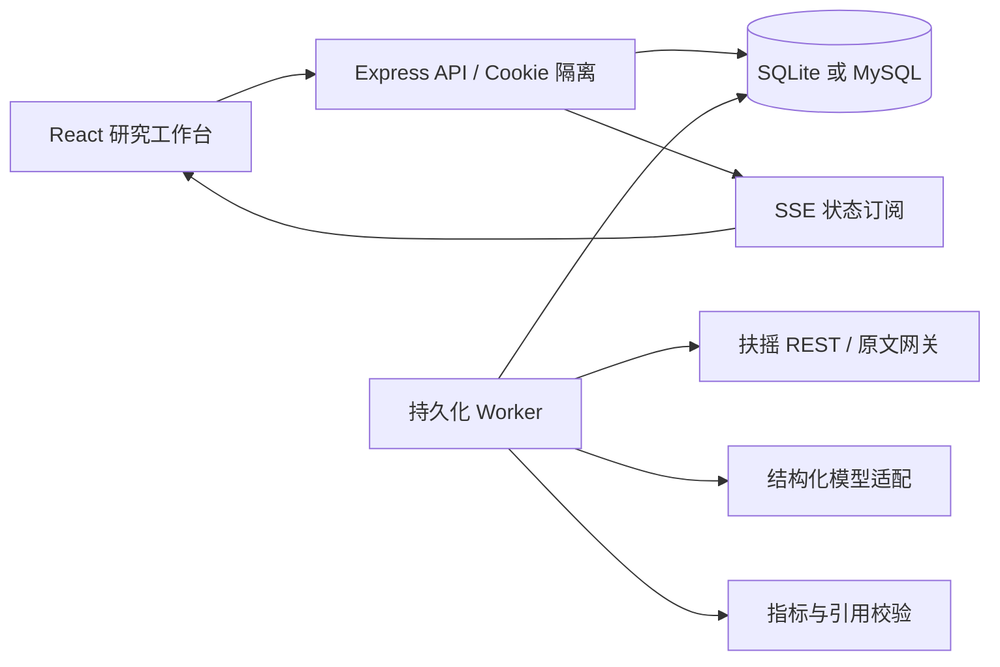
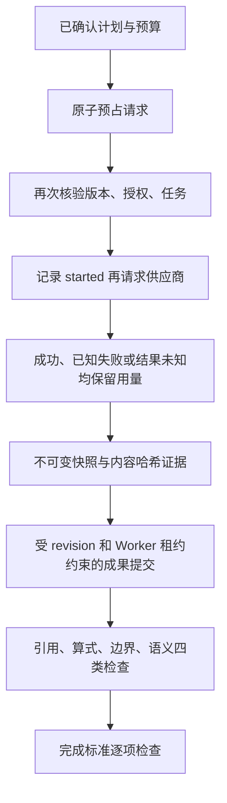

# 运行架构与数据约束

## 组件



运行器外层是固定状态机，模型计划决定研究对象、期间、指标和公开材料检索。计划通过 schema 校验后，完成要求映射到已注册检查器；未知要求明确未达成。第二版在形成核心现金支撑假设后执行最多两项针对判断的核查，修订判断后再生成最终成果。工具范围和一轮／两任务上限包含在审批指纹中。

## 核心对象

`Project` 是数据库聚合：包含 Plan、Task、Evidence、Claim、Report、Checkpoint、ContextSummary、Approval、Usage 和 Event。`Memory` 为跨项目、会话内持久化对象。

两种驱动以 `WHERE revision = previousRevision` 更新聚合。MySQL 精确 payload 使用 JSON 字符串封装，SQLite 保存 JSON 文本；身份、owner 与 revision 单独索引。调用账本和不可变证据独立于聚合，因此旧 revision 或响应未提交不会漏记外部请求。预占通过 SQLite BEGIN IMMEDIATE / MySQL 项目行 FOR UPDATE 串行化。

任务成功时将结果、证据、任务状态和检查点作为同一项目更新提交。外部取数不是数据库事务的一部分，断电可能发生在供应商已响应、结果未落库之间，因此采用可恢复的至少一次外部调用语义。已提交的任务结果复用。

## 状态转换

```text
draft --确认计划--> running --所有任务结束--> completed / partial
running --暂停/故障中断--> paused --继续--> running
running --对象核对失败--> blocked --重试--> running
running --达到上限--> budget_exceeded
budget_exceeded/paused --申请预算--> awaiting_approval --批准--> running
awaiting_approval --拒绝--> 申请扩展前状态（预算耗尽仍保持停止）
draft --拒绝初始审批--> draft（不允许 retry/resume 执行）
任意状态 --取消--> cancelled
非运行状态 --修改范围--> draft（新版本与新审批）
```

`completion.executionFinished` 表示任务结束；`completion.outcome=met` 且无缺口才进入 completed。未注册完成要求、缺字段或核心判断未覆盖时保持 partial。两者均不代表投资判断客观正确。

## 独立持久化边界



预算预占超过60秒不能发起；后续预占或重启释放过期记录。服务恢复将未结算 started 标为 unknown，继续计入调用预算；未知 Token／费用不显示为已知零。规划只获得独立的一次模型调用权限，执行前仍需确认。当前部署以单服务、单后台 Worker 为边界，不是分布式任务系统。

证据 ID 来自规范化内容 SHA-256，包含版本、原值、来源与采集时点。旧证据通过 owner 校验后的独立端点读取。bundle 带当前审批、账本、核查与修订记录，含所有历史证据及来源快照；独立 verifier 校验清单、身份、依赖、算式和原文摘录。哈希保证包内一致性，不是来源真实性签名。

语义上下文保留当前计划最近六条消息、最多八条未验证用户纠正、十八条带引用事实、六条判断和六条修订。模型只接收相关字段摘要／材料原文，不携带完整财务传输快照。模型输入超过60000字符会在请求前停止。

## 约束

1. 名称、证券代码、币种、年度与单位必须匹配授权计划。
2. 公开日期以 Asia/Shanghai 判断，不用 UTC 日期截断造成提前可见。
3. 前期非正不生成普通增长率；净利润非正不生成普通现金利润比。
4. 未授权的工具名称不执行。
5. 原文和用户内容不能成为新的系统权限或代码。
6. 计划与预算使用按键排序的规范序列化计算审批 SHA-256，避免 MySQL JSON 重排失效。
7. 计划版本、审批有效期与指纹均满足才能开始执行。
8. ContextSummary 仅引用证据，原始数据继续保存。
9. 假设记忆明确标记，不能注入为已确认事实。
10. 成本未知不能显示零成本。

## 安全与使用边界

HttpOnly / SameSite=Strict 的 HMAC Cookie 隔离研究空间。写入接口要求 JSON，同源 Origin 校验防止跨站写入。跨会话项目返回 404。密钥不进入前端 bundle；上游错误不回传凭据或完整异常响应。

这不是完整企业认证系统。单进程部署可由 APP_ACCESS_TOKEN 增加访问控制；面向真实多用户需增加账户认证、速率限制的共享存储与配额管理。
